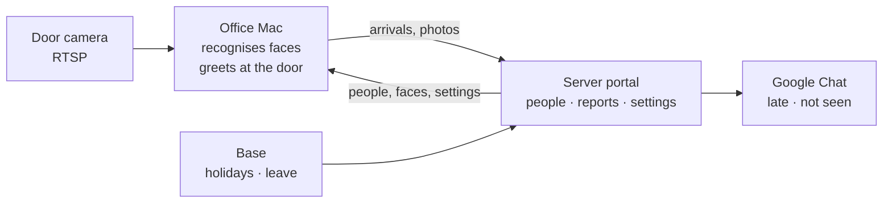

# Camera attendance

The door camera records who arrives and when. Faces are recognised on a computer in the office; the portal on a server shows attendance, posts to Google Chat who is late or missing, and takes holidays and leave from the HR system (Base).

Local Vietnamese speech and custom voice packs: [ZeroTTS setup](docs/voice.md).



| Where | What runs there |
|---|---|
| **Office Mac** (same network as the camera) | camera, face recognition, the greeting at the door; its own page `http://<mac>:8000` keeps only the Camera page (live view, detection area) |
| **Server** (internet, https) | the portal: Today, Review, People, Reports, Settings; Base, Google Chat, Camera API |

Settings are made on the server; the Mac takes them within a minute.

Development conventions: [Mac Camera vs web server responsibilities](docs/architecture.md).
Camera/voice inference runs on the Mac; the server queues work and serves its results.

## Server

Python 3.12, from this repository:

```bash
pip install -r requirements.txt gunicorn
TOKEN=$(python3 -c "import secrets; print(secrets.token_urlsafe(32))")   # give it to the Mac
python3 -c "import hashlib,sys; print(hashlib.sha256(sys.argv[1].encode()).hexdigest())" "$TOKEN"  # -> CHECKIN_EDGE_TOKEN_SHA256
```

Run with exactly **one** worker process (it also runs the scheduled work), behind https:

```bash
CHECKIN_HOME=/srv/checkin \
CHECKIN_ADMIN_PASSWORD=<at least 12 characters> \
CHECKIN_EDGE_TOKEN_SHA256=<hash> \
CHECKIN_PUBLIC_URL=https://checkin.example.com \
CHECKIN_SHADOW=0 \
CHECKIN_OFFICE_URL=http://<mac>:8000 \
gunicorn -w 1 --threads 8 -b 127.0.0.1:8000 attendance.server:application
```

`CHECKIN_HOME` holds `config.yaml`, the database and photos; keep it out of the web root.
**Update:** upload the new code, install `requirements.txt` with the same Python environment
that runs Gunicorn, then restart the service. Updating code alone does not install new libraries.
For a `.venv` deployment, run from the project directory:

```bash
.venv/bin/python -m pip install -r requirements.txt
.venv/bin/python -c "import soundfile, scipy, sounddevice, zerotts; print('Audio dependencies OK')"
```

## Office Mac

Install `FaceAttendance-<version>-macos-*.dmg` from the newest [release](https://github.com/thanhkaiba/rice-camera/releases/latest) (details, Windows and Linux: [docs/install.md](docs/install.md)). Then add the server to `~/Library/Application Support/FaceAttendance/config.yaml` and restart the app:

```yaml
edge:
  server_url: https://checkin.example.com
  token: <TOKEN>
```

Enter the camera's RTSP address on the server (Settings → Camera); draw the detection area on the Mac's own Camera page. Keep the Mac awake and logged in ([docs/install.md](docs/install.md#keep-it-running)). It updates itself from new releases outside camera hours.

## More

- Using the portal, how late is counted, HR system, accuracy, privacy: [docs/usage.md](docs/usage.md)
- Recognition and tuning: [docs/recognition.md](docs/recognition.md) · Base / HR API: [docs/hr-api.md](docs/hr-api.md) · Late fines API: [docs/CAMERA-API.md](docs/CAMERA-API.md)
- The default `insightface` models are **non-commercial research only**; company use needs a licence, or `backend: opencv` (free, less accurate).
- Face photos are personal data: inform employees and get consent.

## Development

```bash
pip install -r requirements-dev.txt
python -m pytest          # no models or camera needed
```

Release: `git tag v1.2.0 && git push origin v1.2.0`; GitHub Actions builds the installers and the Macs update themselves.
