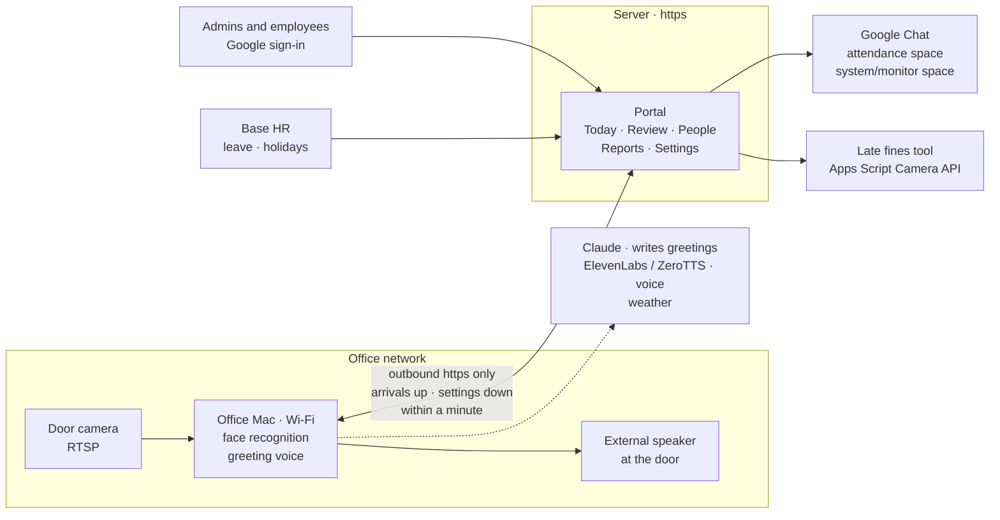
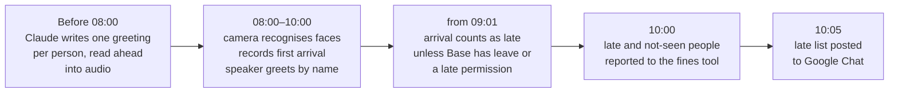
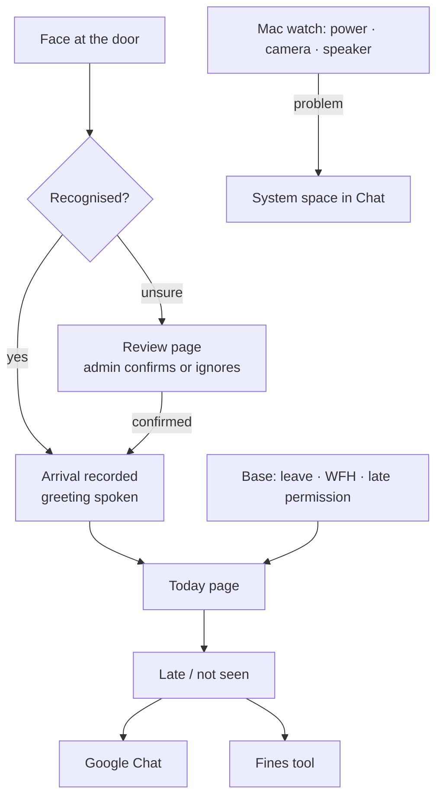

# Camera attendance

The door camera records who arrives and when. Faces are recognised on a computer in the office; the portal on a server shows attendance, posts to Google Chat who is late or missing, and takes holidays and leave from the HR system (Base).

Local Vietnamese speech and custom voice packs: [ZeroTTS setup](docs/voice.md).

Google sign-in and employee admin/viewer access: [setup guide](docs/google-login.md).

## How it is deployed today

One office, one door camera, 52 people. Live since 20 Oct 2026.



| Where | What runs there |
|---|---|
| **Office Mac** (same network as the camera) | camera, face recognition, the greeting at the door, speaker and power watch; its own page keeps only the Camera view |
| **Server** (internet, https) | the portal, Base, Google Chat, late fines report, Google sign-in |

No inbound port to the office: the Mac calls the server. Settings are made on the server.
Development conventions: [Mac Camera vs web server responsibilities](docs/architecture.md).

## What it does every work day





| Use case | State |
|---|---|
| Attendance from the door camera, late and not-seen lists | live |
| Leave, WFH and late permissions from Base (pending requests can count as approved) | live |
| Late list in Google Chat | live, 10:05 |
| Late fines report to the Camera API | live, once a day at 10:00, no human confirmation step yet |
| Spoken greeting per person (Claude text, ElevenLabs v3 voice with emotions, weather, trends) | live |
| Review page for unsure faces, photo collection for new references | live |
| Alerts: charger, battery, camera, speaker output / mute / volume | live |
| Google sign-in for employees, installable web app | deployed; real sign-in not yet confirmed by us |
| Fine notice with appeals before the report | built, switched off |

## Results so far

Measured on the office Mac and the portal, 19 Nov 2026.

| | |
|---|---|
| People enrolled | 52, all with reference faces (1,459 face vectors) |
| Camera arrivals per day, last full days | 31 · 36 · 30 · 35 (13, 17, 18, 19 Nov) |
| 19 Nov on the portal | 19 on time · 5 late · 2 not seen · 20 on leave · 3 WFH · 18 with a late permission |
| Faces left for a person to check, 19 Nov | 7 in Review; 1 arrival confirmed by hand |
| Greetings spoken | 29 on 18 Nov · 35 on 19 Nov |
| Fines report, 19 Nov | 23 events accepted, 1 rejected by the fines tool |
| Camera stream, 08:00–10:00 on 19 Nov | 11 drops of 1–8 s, about 31 s in total; reconnects by itself |
| Typical match score of an accepted face | 0.51–0.56 daily average |

Known weak points, from real days:

- **16 Nov**: the camera could not be opened for most of the morning; 4 arrivals recorded. A long outage still needs a person.
- The stream drops every 30 minutes (camera side) and the Mac is on Wi-Fi.
- A speaker switched off at its own button is invisible to the Mac; the Settings page has a test button.
- A wrong or missing reference photo sends a face to Review instead of recording it.

## Server

Python 3.12, from this repository:

```bash
pip install -r requirements.txt gunicorn
TOKEN=$(python3 -c "import secrets; print(secrets.token_urlsafe(32))")   # give it to the Mac
python3 -c "import hashlib,sys; print(hashlib.sha256(sys.argv[1].encode()).hexdigest())" "$TOKEN"  # -> CHECKIN_EDGE_TOKEN_SHA256
```

Run with exactly **one** worker process (it also runs the scheduled work), behind https:

```bash
CHECKIN_HOME=/srv/checkin \
CHECKIN_ADMIN_PASSWORD=<at least 12 characters> \
CHECKIN_EDGE_TOKEN_SHA256=<hash> \
CHECKIN_PUBLIC_URL=https://checkin.example.com \
CHECKIN_SHADOW=0 \
CHECKIN_OFFICE_URL=http://<mac>:8000 \
gunicorn -w 1 --threads 8 -b 127.0.0.1:8000 attendance.server:application
```

`CHECKIN_HOME` holds `config.yaml`, the database and photos; keep it out of the web root.
**Update:** upload the new code, install `requirements.txt` with the same Python environment
that runs Gunicorn, then restart the service. Updating code alone does not install new libraries.
For a `.venv` deployment, run from the project directory:

```bash
.venv/bin/python -m pip install -r requirements.txt
.venv/bin/python -c "import soundfile, scipy, sounddevice, zerotts; print('Audio dependencies OK')"
```

## Office Mac

Install `FaceAttendance-<version>-macos-*.dmg` from the newest [release](https://github.com/thanhkaiba/rice-camera/releases/latest) (details, Windows and Linux: [docs/install.md](docs/install.md)). Then add the server to `~/Library/Application Support/FaceAttendance/config.yaml` and restart the app:

```yaml
edge:
  server_url: https://checkin.example.com
  token: <TOKEN>
```

Enter the camera's RTSP address on the server (Settings → Camera); draw the detection area on the Mac's own Camera page. Keep the Mac awake and logged in ([docs/install.md](docs/install.md#keep-it-running)). It updates itself from new releases outside camera hours.

## More

- Using the portal, how late is counted, HR system, accuracy, privacy: [docs/usage.md](docs/usage.md)
- Recognition and tuning: [docs/recognition.md](docs/recognition.md) · Base / HR API: [docs/hr-api.md](docs/hr-api.md) · Late fines API: [docs/CAMERA-API.md](docs/CAMERA-API.md)
- The default `insightface` models are **non-commercial research only**; company use needs a licence, or `backend: opencv` (free, less accurate).
- Face photos are personal data: inform employees and get consent.

## Development

```bash
pip install -r requirements-dev.txt
python -m pytest          # no models or camera needed
```

Release: `git tag v1.2.0 && git push origin v1.2.0`; GitHub Actions builds the installers and the Macs update themselves.
