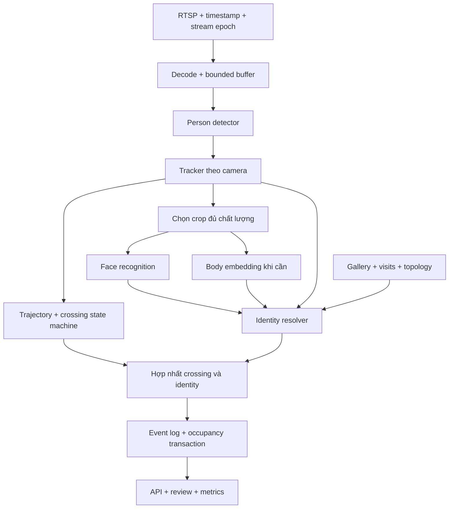

# Person Re-ID, ENTRY/EXIT và occupancy: nghiên cứu và thiết kế

Ngày: 2026-10-27. Trạng thái: đề xuất, chưa triển khai và chưa benchmark trên camera của project.

Tài liệu ghi lại nội dung nghiên cứu từ trao đổi về hệ thống nhận diện người khi vào bằng mặt và xác định người ra khi chỉ nhìn thấy lưng. Đánh giá code hiện có và kế hoạch tận dụng nằm ở [project review](person-reid-project-review.md).

## 1. Mục tiêu và giới hạn khả thi

Luồng mục tiêu: detect người → theo dõi → dùng mặt làm mốc danh tính → thu body embeddings → khi người quay lưng hoặc tái xuất hiện, kết hợp lịch sử tracking, ngoại hình, thời gian, không gian và trạng thái khu vực → xác nhận crossing → cập nhật visit nếu danh tính đủ tin cậy.

Hệ thống khả thi với điều kiện camera đủ chất lượng, cửa được quan sát và chấp nhận kết quả chưa xác định. Không thể bảo đảm xác minh một người từ bóng lưng trong mọi trường hợp, đặc biệt khi đồng phục, đổi trang phục, occlusion hoặc mất dấu dài. Người giống nhất trong gallery không nhất thiết là người đúng; có thể không có người đúng trong gallery.

Ưu tiên giảm gán nhầm người và false EXIT hơn tăng FPS hoặc ép mọi crossing có tên.

| Thành phần | Vai trò | Không tự bảo đảm |
|---|---|---|
| Person detection | Person box và detection score | Danh tính |
| Multi-object tracking | Liên kết detection thành quỹ đạo | Không có ID switch |
| Face recognition | So khớp mặt với người đăng ký | Mọi góc mặt đều đủ chất lượng |
| Person Re-ID | Truy hồi người có ngoại hình phù hợp | Xác minh danh tính tuyệt đối |
| Event detection | Xác nhận đi qua cửa và hướng | Biết người đi qua là ai |

Local track ID thuộc một camera/stream epoch; global person identity thuộc hệ thống. Association giữa chúng phải có trạng thái, bằng chứng, thời gian hiệu lực và khả năng thu hồi khi có mâu thuẫn.

## 2. Phương án camera

| Phương án | Lợi ích | Trade-off |
|---|---|---|
| Một camera, giữ tracking liên tục | Ít thiết bị, trực tiếp kế thừa face anchor | Khó tối ưu cả mặt và toàn thân; occlusion phá continuity |
| Một camera, Re-ID sau mất dấu | Đáp ứng tình huống chỉ thấy lưng lúc ra | Phải chấp nhận PROBABLE/UNKNOWN |
| Hai camera nhìn hai hướng cùng cửa | Thêm cơ hội thấy mặt khi ra, thêm góc body | Đồng bộ thời gian, topology, chống trùng crossing |

Đề xuất production: thử camera thứ hai sớm nếu false EXIT gây hậu quả đáng kể. Camera thứ hai cần bổ sung góc nhìn thiếu, không chỉ lặp lại cùng góc lưng. Một vùng overlap gần cửa giúp liên kết bằng thời gian/hình học. Homography mặt sàn áp dụng cho điểm chân, không cho mọi điểm cơ thể. Hai camera phải hợp nhất thành một sự kiện tại gate.

## 3. Model shortlist và mức độ bằng chứng

FastReID là framework; khi benchmark phải chọn backbone, recipe, checkpoint cụ thể. Không thể so “OSNet với FastReID” như hai model cố định.

| Ứng viên | Giá trị | Trade-off / hướng dùng |
|---|---|---|
| OSNet-x1.0 / x0.5 | Baseline global embedding nhỏ | Điểm xuất phát; partial crop và đổi đồ cần kiểm chứng |
| FastReID BoT/SBS R50-IBN | Baseline CNN đối chứng | Thường nặng hơn OSNet; kiểm tra converter với runtime cụ thể |
| TransReID | Transformer với representation global/local | Thêm tài nguyên và công việc export |
| CLIP-ReID | Khai thác pretraining vision-language | Benchmark đúng nhánh inference; không cần chạy mô hình ngôn ngữ sinh văn bản |
| SOLIDER-ReID Swin-Tiny | Human-centric pretrained representation | Challenger chất lượng; cần chuẩn hóa môi trường nghiên cứu |
| BPBReID / KPR | Embedding theo bộ phận và visibility | Phù hợp partial/occlusion; keypoint prompt bổ sung chi phí pose khi dùng |
| COPE | Hướng mới về occluded Re-ID | Tái lập kết quả, kiểm tra weights/export/license trước lựa chọn |
| LCC-ReID và cloth-changing models | Nghiên cứu thay trang phục qua thời gian | Bài toán riêng, không mặc định giải quyết đồng phục/back-only |

Các số liệu công bố để tham khảo, không phải benchmark công bằng giữa kiến trúc:

| Model / cấu hình | Dataset | Rank-1 | mAP |
|---|---|---:|---:|
| OSNet-x1.0 | MSMT17 | 74,9% | 43,8% |
| FastReID BoT-R50-IBN | MSMT17 | 77,0% | 54,4% |
| SOLIDER Swin-Tiny, không re-ranking | MSMT17 | 85,9% | 67,4% |

Nguồn: [Torchreid](https://kaiyangzhou.github.io/deep-person-reid/MODEL_ZOO), [FastReID model zoo](https://github.com/JDAI-CV/fast-reid/blob/master/MODEL_ZOO.md), [SOLIDER-ReID](https://github.com/tinyvision/SOLIDER-REID). Pretraining, recipe và protocol khác nhau; không suy ra accuracy trên camera của project.

Torchreid ghi OSNet-x1.0 khoảng 2,2M parameters / 0,98 GFLOPs và x0.5 khoảng 0,6M / 0,27 GFLOPs ở input 256×128. Parameter count không phải peak VRAM. Peak gồm weights, activations, runtime/workspace, decode/buffers và concurrency.

Vòng benchmark đầu: OSNet-x1.0, FastReID BoT-R50-IBN và một trong SOLIDER Swin-Tiny/CLIP-ReID. Thêm KPR khi phân tích lỗi xác định partial crop hoặc crop chứa nhiều người là vấn đề lớn. Chọn theo coverage tại false assignment budget cố định, latency và VRAM; không theo Rank-1 đơn lẻ.

Các model Python/PyTorch có triển vọng export không đồng nghĩa đã hỗ trợ ONNX/TensorRT đầy đủ. FastReID có converter công bố; mọi model vẫn cần kiểm tra graph, preprocessing, precision và output parity.

## 4. Kiến trúc đề xuất



Event detection không chờ biết danh tính. Một crossing có thể chắc chắn trong khi người đi qua còn UNKNOWN.

Giữ Python cho inference. Tận dụng API hiện có thay vì mặc định thêm Node.js/Go. Một service sở hữu cập nhật occupancy. PostgreSQL là hướng khi nhiều worker/node cần transaction chung; single-node MVP có thể giữ SQLite nếu các writer phối hợp trong một process và transaction đúng.

Production cần stream epoch, kết quả inference gắn frame/track generation, queue giới hạn, xử lý kết quả trễ, event idempotency, transaction event+visit, model/config version, restart recovery và degraded state khi thiếu quan sát. Mất camera không có nghĩa mọi người đã EXIT.

## 5. Face anchor và Identity Resolver

Face pipeline: detect → quality check → alignment → open-set match → associate đúng face với person → tạo identity anchor. Face nằm trong person box chưa đủ khi box chồng nhau; association mơ hồ phải có lựa chọn reject.

Giữ riêng detection score, face similarity, body similarity, identity score và event score. Similarity không phải xác suất. Chỉ gọi điểm tổng hợp là probability sau calibration trên dữ liệu tách biệt.

Resolver theo thứ tự:

1. Reject crop sai người, quá nhỏ/mờ hoặc che khuất nặng.
2. Ưu tiên ứng viên có visit đang mở, vị trí cuối và thời gian hợp lý.
3. Luôn giữ giả thuyết unknown/missed ENTRY; occupancy chỉ là prior.
4. Kiểm tra mâu thuẫn face, ID switch, xuất hiện đồng thời bất khả thi.
5. Tổng hợp theo tracklet: chất lượng, face/body, continuity, temporal/spatial evidence.
6. Kiểm tra ngưỡng tuyệt đối, top-1/top-2 margin và ổn định qua thời gian.
7. Confirm, giữ probable hoặc abstain; không bắt buộc chọn ứng viên.

| Trạng thái | Chính sách |
|---|---|
| CONFIRMED | Đạt đường xác nhận đã kiểm chứng và không có mâu thuẫn đáng kể |
| PROBABLE | Có ứng viên tốt nhưng thiếu bằng chứng hoặc còn cạnh tranh |
| UNKNOWN | Không đủ chất lượng, không có ứng viên hoặc bằng chứng mâu thuẫn |

MVP xác nhận bằng face chất lượng tốt hoặc continuity từ face anchor không có dấu hiệu mơ hồ. Body-only sau mất dấu dài giữ PROBABLE cho tới khi benchmark cho phép tự động hóa đường này.

Rule gates rõ ràng là đủ lúc đầu. Sau khi có dữ liệu, có thể dùng logistic regression/calibration với similarity, quality, missing-modality flags, margin, continuity, elapsed time, spatial feasibility, gallery age và số ứng viên. Không nhân confidence như thể độc lập: màu áo và body embedding có thể phản ánh cùng thông tin. Nhiều frame liền nhau cũng tương quan.

Nhiều người đồng thời cần assignment chung có lựa chọn không ghép. Không gán hai người vật lý khác nhau cùng identity; camera overlap là ngoại lệ hợp lệ theo topology.

## 6. Body gallery và các trường hợp khó

Body gallery gắn với person + visit + appearance session. Lưu model/preprocess version, camera, timestamp, viewpoint (front/side/back/unknown), visibility, quality và nguồn face/track anchor.

- Giữ exemplar thực tế đa dạng góc; ngân sách thử ban đầu 6–12 mẫu/session, chưa phải giá trị tối ưu.
- Không chỉ trung bình front/side/back thành một vector; không lấy max trên gallery tăng vô hạn.
- Không nhập mẫu PROBABLE vào trusted gallery; ngừng học khi nghi ID switch.
- Kết thúc visit thì gallery không còn là ngoại hình hiện tại mặc định.
- Đổi model cần re-embed hoặc giữ space version riêng; không so chéo embedding spaces.
- Đổi áo/balô tạo appearance session mới khi có anchor đáng tin; không tự suy ra identity từ body.

Partial vs full-body: chỉ so phần cùng quan sát được bằng model hỗ trợ part visibility; nếu thiếu phần chung thì reject. Không coi crop chân đưa vào global full-body encoder là score tương đương toàn thân. RGB→IR cũng là domain khác cần đánh giá riêng.

Đồng phục: ưu tiên continuity, mặt từ góc khác, exemplar cùng visit, chi tiết giày/balô nếu đủ pixel, rồi abstain. Chiều cao pixel phải hiệu chuẩn phối cảnh. Gait, pose mọi frame và ensemble nhiều model chưa cần trong MVP.

Exact cosine trên candidate gallery trong RAM là baseline đơn giản. 1.000 người × 10 vector × 512 chiều × float32 khoảng 20,5 MB vector thô, chưa tính metadata. Chưa cần vector DB riêng ở quy mô này.

## 7. Tracking và crossing

ByteTrack là baseline; benchmark BoT-SORT khi giao cắt/occlusion tạo nhiều ID switches. Không mặc định implementation BoT-SORT đã bật appearance encoder. Tái sử dụng embedding giữa tracker/resolver nếu model và preprocessing trùng nhau.

Timeout phải dựa vào elapsed time; prediction không phải observation. Khi nghi đổi người, chia track segment và xem xét lại identity anchor. Không kế thừa identity chỉ vì số local track ID không đổi.

Crossing dùng OUTSIDE ⇄ TRANSITION ⇄ INSIDE, hai đường hoặc polygons, điểm chân, hysteresis, dwell/quan sát thật, hướng và gate ID. ENTRY là chuỗi ngoài→chuyển tiếp→trong, EXIT là chiều ngược lại. Spawn trong vùng không tự là ENTRY; biến mất khỏi ảnh không tự là EXIT. Gap lớn thì crossing chưa xác định.

Re-arm sau khi ổn định ở phía mới để người vào rồi quay ra có hai sự kiện hợp lệ. Cooldown dài đơn giản có thể bỏ sót lần thứ hai. Chống trùng cả retry của cùng event và track fragmentation/multi-camera cùng crossing.

```json
{
  "event_type": "PERSON_EXIT",
  "crossing_status": "CONFIRMED",
  "person_id": null,
  "candidate_person_id": "user_001",
  "identity_source": "PERSON_REID",
  "identity_status": "PROBABLE",
  "track_uid": "cam_01:epoch_42:152",
  "direction": "EXIT",
  "occurred_at": "2026-10-27T17:00:00+07:00",
  "occupancy_applied": false
}
```

## 8. Occupancy và schema mục tiêu

Tách số người theo crossing và danh sách identity có visit mở. A/B đang trong khu vực, có một anonymous EXIT: không tự đóng visit A hoặc B; gắn ambiguity và đối soát. Không tiếp tục hiển thị cả hai là chắc chắn đang trong. Count chỉ đáng tin khi mốc ban đầu và mọi đường ra/vào được quan sát; mất dữ liệu phải hiển thị degraded.

| Bảng logic | Dữ liệu chính |
|---|---|
| persons / employees | Identity, trạng thái |
| face_templates | Vector, quality, model/preprocessing version |
| cameras / gate_configs | Camera ID, topology, line/polygon, config version |
| tracklets / observations | Stream epoch, local ID, timestamp, bbox, selected evidence |
| identity_associations | Track segment, candidate/confirmed person, status, evidence, revision |
| visits | Person nullable, zone, entry/exit event, trạng thái |
| body_templates | Visit, appearance session, vector, viewpoint, quality, provenance |
| crossing_events | Gate, hướng, occurred/received time, hai trạng thái, idempotency key |
| event_revisions | Quyết định sửa, actor, lý do, timestamp |

Unique camera+epoch+local ID; unique idempotency key; tối đa một confirmed open visit/người/zone khi nghiệp vụ yêu cầu. Event+visit cập nhật nguyên tử, khóa tránh hai EXIT đồng thời. Lưu UTC, hiển thị timezone địa phương. Không sửa lịch sử âm thầm. Clip/crop ngoài bảng transaction, DB giữ URI/checksum. Lưu quan sát chọn lọc và cửa sổ ngắn, không ghi mọi bbox vô thời hạn.

Dữ liệu sinh trắc, crop và RTSP credentials cần phân quyền, retention/xóa và bảo vệ khi lưu/truyền. Giấy phép code và weights kiểm tra riêng; InsightFace pretrained weights không mặc định cho phép dùng thương mại.

## 9. Hiệu năng

Giá trị dưới đây chỉ để bắt đầu thử: detector 8–15 Hz, tăng gần cửa/cảnh đông; face khi có crop mới đủ chất lượng; body khi cần gallery/reassociation; search theo tracklet/event. Tần suất phải đủ quan sát hành trình qua transition zone. Không giảm FPS đến mức người nhảy qua toàn vùng giữa hai lần detect.

Bounded queue, frame age metric, drop frame cũ khi quá tải và ghi gap. Batching crop nhỏ với giới hạn chờ. Theo dõi mật độ người, không chỉ camera count.

Thứ tự: ORT CUDA baseline → profile decode/preprocess/copy/inference/DB → FP16/TensorRT khi có bottleneck → hardware decode nếu có lợi. Kiểm tra provider thực chạy, CPU fallback và engine cache. Đo peak VRAM cùng concurrency. Sau export/quantization kiểm tra embedding drift, ranking và quyết định gần ngưỡng; INT8 để sau calibration dataset đại diện.

## 10. Benchmark và nghiệm thu

Thu video đi riêng/nhóm/ngược chiều/quay đầu; đồng phục; front→back; partial; đổi đồ; ánh sáng ngày/đêm; khách chưa đăng ký; missed ENTRY; disconnect/restart/drop frames; một/hai camera. Ground truth gồm identity, track, crossing time/direction và occupancy; không tự gán danh tính cho đoạn không đủ bằng chứng.

Tách train/validation/test theo ngày/visit, có held-out identities nếu fine-tune. Không random split frame gần nhau. Replay causal: gallery tại thời điểm t chỉ chứa bằng chứng trước t. Chốt threshold trên validation rồi đánh giá test giữ lại.

| Nhóm | Metric |
|---|---|
| Retrieval | Rank-1, mAP; tách front→back, back→back, partial→full |
| Open-set identity | False identification, reject rate, wrong assignment, coverage |
| Tracking | ID switches, fragmentation, IDF1, HOTA |
| Event | ENTRY/EXIT precision/recall, hướng sai, duplicates |
| Identified event | Đúng identity+gate+direction+time tolerance |
| Occupancy | Count MAE, identity-set precision/recall, thời gian trạng thái sai |
| Runtime | p50/p95/p99 latency, frame age, queue, peak VRAM, drops |

Định nghĩa mẫu số:

- Pairwise FMR = cặp khác người vượt ngưỡng / tổng cặp khác người.
- Wrong assignment = gán sai / quyết định đã gán identity.
- False EXIT = EXIT không khớp crossing thật / tổng EXIT dự đoán.
- Wrong-person EXIT = crossing EXIT thật nhưng sai identity / tổng EXIT đã gán identity.
- Coverage = crossing tự gán identity / tổng crossing thật.

Rank-1/mAP không đo đầy đủ unknown rejection. Pairwise FMR không thay thế lỗi 1:N theo gallery size. So sánh model tại cùng coverage hoặc cùng risk budget. Ablation: face+tracking → +body → +constraints → +quality/reject → +multi-view gallery → +camera thứ hai.

Không tuyên bố sai số cực thấp từ ít lượt. Nếu 0 lỗi trong n phép thử độc lập, cận trên 95% xấp xỉ 3/n: mục tiêu minh họa 0,1% cần khoảng 3.000 lượt không lỗi; frame tương quan không phải phép thử độc lập. Cần nhiều ngày/người/tình huống.

## 11. Failure cases và roadmap

Lỗi cần thử trực tiếp: face A gắn body B, identity giữ sau ID switch, gallery tự học mẫu probable, hai người đồng phục cùng ra, quay đầu, occupancy đã sai, camera mất dữ liệu, model đổi nhưng threshold giữ nguyên, buffer chứa frame cũ.

Roadmap: khảo sát và tiêu chí → replay offline có ground truth → shadow mode → tự động hóa đường face/continuity đã kiểm chứng → thử Re-ID tốt hơn/camera thứ hai → production với rollback, versioning, monitoring, retention và recovery.

MVP cần detector, tracker, face anchor, một body encoder, resolver có reject, crossing state machine, event log, occupancy và review. Chưa cần Kafka, Kubernetes, vector DB riêng, gait, ensemble, online self-training hay backend ngôn ngữ thứ hai.

## 12. Nguồn chính thức đã đối chiếu trong nghiên cứu

- [Torchreid / OSNet model zoo](https://kaiyangzhou.github.io/deep-person-reid/MODEL_ZOO)
- [FastReID](https://github.com/JDAI-CV/fast-reid)
- [TransReID](https://github.com/damo-cv/TransReID)
- [CLIP-ReID](https://github.com/Syliz517/CLIP-ReID)
- [SOLIDER-ReID](https://github.com/tinyvision/SOLIDER-REID)
- [BPBReID](https://github.com/VlSomers/bpbreid) và [KPR](https://github.com/VlSomers/keypoint_promptable_reidentification): có điều khoản license riêng, không mặc định permissive chỉ vì code công khai.
- [COPE](https://github.com/Cecoming/COPE): thông tin dựa trên repository tác giả; trang paper CVF không tải được trong phiên nghiên cứu.
- [LCC-ReID](https://proceedings.mlr.press/v306/shi26m.html)
- [ByteTrack](https://github.com/ifzhang/ByteTrack), [BoT-SORT](https://github.com/NirAharon/BoT-SORT)
- [InsightFace license](https://github.com/deepinsight/insightface#license)
- [ORT CUDA](https://onnxruntime.ai/docs/execution-providers/CUDA-ExecutionProvider.html), [ORT TensorRT](https://onnxruntime.ai/docs/execution-providers/TensorRT-ExecutionProvider.html)
- [TrackEval](https://github.com/JonathonLuiten/TrackEval)

Các kết quả công bố chưa được tái lập trong project. Chưa đo GPU latency/VRAM, back-only accuracy hay false EXIT trên dữ liệu thực tế.
